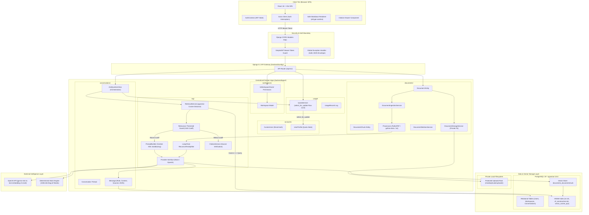

# System Architecture & Technical Blueprint
**Deliverable ID:** `02_architecture`  
**Project:** AI Document Intelligence Workspace (RAG SaaS)  
**Date:** October 2026  
**Status:** Approved & Implemented  

---

## 1. High-Level Architectural Diagram

The diagram below illustrates the end-to-end multi-tier architecture, spanning the client application, API gateway, multi-tenant Django domain services, PostgreSQL pgvector storage, and AI providers.



---

## 2. Tier-by-Tier Architectural Breakdown

### 2.1 Client Tier (React 18 + Vite)
- **Framework:** React 18 SPA bundled with Vite 8.3.
- **Styling Architecture:** Vanilla CSS Design System with dark glassmorphism, semantic CSS tokens (`--accent-primary`, `--bg-card`, `--border-subtle`), and responsive layout grids.
- **State & Networking:** Single `AuthContext` managing JWT token persistence. Axios HTTP interceptor automatically captures 401 Unauthorized responses to perform refresh token rotation without user disruption.
- **Security & XSS Neutralization:** All AI-generated Markdown answers pass through `react-markdown` configured with `rehype-sanitize`. Zero arbitrary raw HTML or script tags can execute in the DOM.

### 2.2 Security & Authentication Boundary
- **Stateless Tokens:** SimpleJWT produces short-lived HMAC-SHA256 access tokens and cryptographically random refresh tokens.
- **Tenant Boundary:** The `IsWorkspaceOwner` DRF permission class intercepts every request targeting documents, chunks, or conversations. Querysets are strictly scoped:
  ```python
  queryset = Document.objects.filter(workspace__owner=request.user)
  ```
- **Error Sanitization:** `config.exceptions.custom_exception_handler` intercepts all unhandled backend exceptions, preventing PostgreSQL internal schemas, file paths, or stack traces from reaching clients.

### 2.3 Document Ingestion & Vectorization Subsystem
- **Format Ingestion:** 
  - PDF: PyMuPDF extracts text page-by-page while preserving 1-indexed `page_number`.
  - DOCX: `python-docx` iterates through paragraph runs and tabular cells.
  - TXT: UTF-8 stream decoding with strict character normalizer.
- **LangChain Chunking:** `RecursiveCharacterTextSplitter` segments text using hierarchy `["\n\n", "\n", " ", ""]` into 800-character segments with 100-character overlap.
- **Storage:** Physical files reside in a non-publicly served directory (`MEDIA_ROOT/uploads/`) identified only by cryptographically generated UUID filenames.

### 2.4 Retrieval-Augmented Generation (RAG) Subsystem
- **Index:** PostgreSQL 18 with `pgvector 0.8.6` HNSW graph index (`idx_chunk_embedding_hnsw`).
- **Cosine Distance:** Uses PostgreSQL `<=>` operator to compute distance between query vector and chunk vectors.
- **Relevance Gate (Hallucination Defense):** If the minimum distance of the top 5 retrieved chunks exceeds `0.65` (i.e. cosine similarity $< 0.35$), the system immediately short-circuits the pipeline and returns:
  *"I couldn't find this information in the uploaded documents."*
  **Zero tokens are sent to external LLMs for irrelevant queries.**
- **Prompt Sandboxing:** Retrieved chunks are injected inside `<context>` XML tags. The system prompt instructs the model to treat document content strictly as data, neutralizing prompt-injection attacks.

### 2.5 Concurrency & Atomic Quota Subsystem
- **Policy:** 20 queries per user per calendar day (UTC).
- **Locking:** `QuotaService.reserve_question_quota()` executes inside a `transaction.atomic()` block using PostgreSQL `select_for_update()` on `UserProfile`.
- **Compensation Refund:** If downstream AI or network failures occur after quota deduction, the system automatically calls `refund_question_quota()`, restoring the user's quota.

---

## 3. Lucidchart Export Specification

For review in Lucidchart or external diagramming tools:
- **Shape Palette:** Cloud Architecture / UML Deployment.
- **Security Group Boundary:** Surrounds all `backend/apps/` domain modules.
- **Database Boundary:** Contains PostgreSQL tables and HNSW index nodes.
- **Storage Boundary:** Depicts local filesystem disk and future AWS S3 object store.
