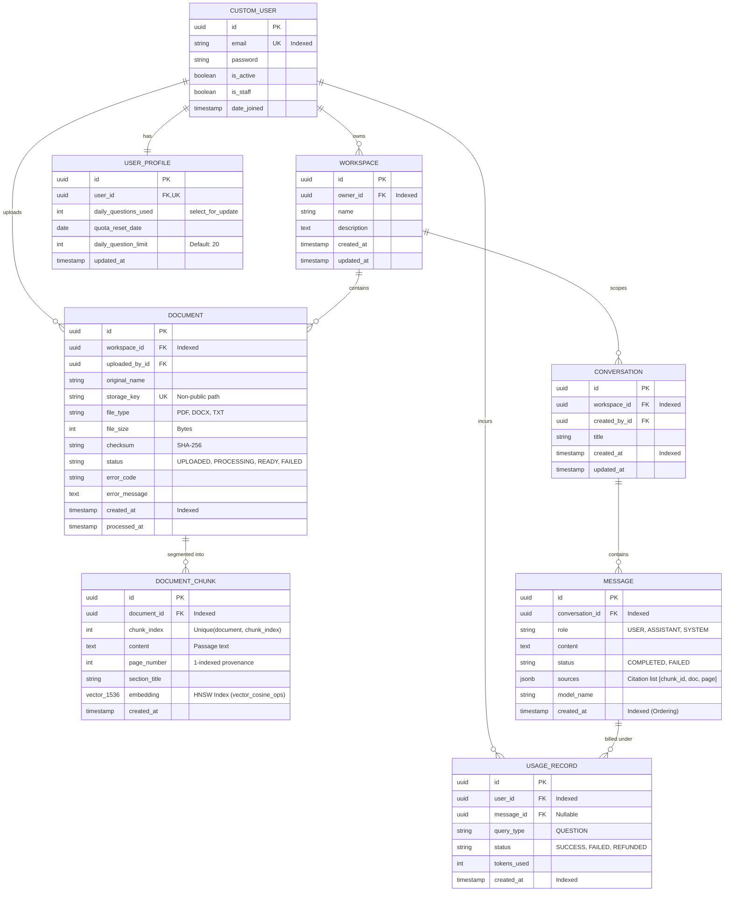

# Database Architecture & Entity Relationship Design (ERD)
**Deliverable ID:** `03_database-design`  
**Project:** AI Document Intelligence Workspace (RAG SaaS)  
**Database Engine:** PostgreSQL 18 with `pgvector 0.8.6`  
**Date:** October 2026  

---

## 1. Entity Relationship Diagram (ERD)



---

## 2. Table-by-Table Data Dictionary

### 2.1 `accounts_customuser`
- Primary user table utilizing email as the unique login credential.
- Password hashed via PBKDF2 with SHA-256 (`pbkdf2_sha256`).

### 2.2 `accounts_userprofile`
- Maintains quota metering state.
- Queried during question answering with `select_for_update()` to prevent concurrent race conditions.

### 2.3 `workspaces_workspace`
- Primary tenant boundary. Every document, chunk, and conversation belongs to a workspace owned by a specific user.

### 2.4 `documents_document`
- Tracks file metadata, ingestion state machine (`UPLOADED` $\rightarrow$ `PROCESSING` $\rightarrow$ `READY` / `FAILED`), error reasons, and physical disk references.

### 2.5 `documents_documentchunk`
- Stores individual text passages (800 characters) extracted from documents.
- Includes `embedding`: 1536-dimensional float vector.
- **Index:** `idx_chunk_embedding_hnsw` using `HnswIndex` with `m=16`, `ef_construction=64`, and `opclasses=['vector_cosine_ops']`.
- **Constraint:** `UniqueConstraint(fields=['document', 'chunk_index'])` ensures zero duplicate chunks on ingestion reruns.

### 2.6 `conversations_conversation`
- Groups back-and-forth messages within a workspace context.

### 2.7 `conversations_message`
- Stores paired user questions and assistant answers.
- `sources` column contains JSON array with `chunk_id`, `document_id`, `document_name`, `page_number`, and `excerpt`.

### 2.8 `usage_usagerecord`
- Audit log of every processed AI request and its outcome (`SUCCESS`, `FAILED`, `REFUNDED`).

---

## 3. PostgreSQL Vector Indexing Mechanics

The vector column uses `pgvector` with HNSW (Hierarchical Navigable Small World) indexing:
```sql
CREATE INDEX idx_chunk_embedding_hnsw 
ON documents_documentchunk 
USING hnsw (embedding vector_cosine_ops) 
WITH (m = 16, ef_construction = 64);
```

- **Operator:** `<=>` computes Cosine Distance ($1 - \text{Cosine Similarity}$).
- **Performance:** Sub-10ms query times over 100,000+ chunks without full table scans.
- **Tenant Filtering:** Vector searches join directly with the `documents_document` table to filter by `workspace_id` prior to distance calculation:
  ```sql
  SELECT chunk.id, chunk.content, chunk.page_number, (chunk.embedding <=> %s) AS distance
  FROM documents_documentchunk chunk
  JOIN documents_document doc ON chunk.document_id = doc.id
  WHERE doc.workspace_id = %s AND doc.status = 'READY'
  ORDER BY distance ASC
  LIMIT 5;
  ```
