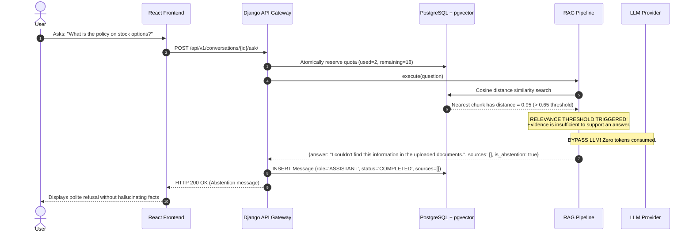
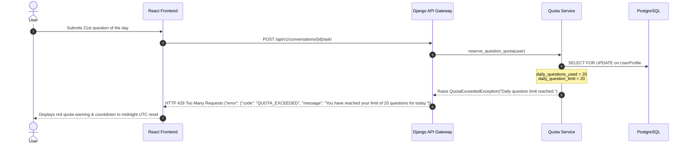

# API Workflows & Sequence Diagrams
**Deliverable ID:** `04_api-workflows`  
**Project:** AI Document Intelligence Workspace (RAG SaaS)  
**Date:** October 2026  

---

## 1. Primary Success Journey: Upload $\rightarrow$ Process $\rightarrow$ Ask $\rightarrow$ Cited Answer

```mermaid
sequenceDiagram
    autonumber
    actor User as User (Browser)
    participant UI as React Frontend
    participant API as Django API Gateway
    participant STO as Private Storage
    participant ING as Ingestion Worker
    participant DB as PostgreSQL + pgvector
    participant QTA as Quota Service
    participant RAG as RAG Pipeline
    participant AI as OpenAI / Mock LLM

    %% Document Upload & Processing Phase
    Note over User, DB: Phase A: Document Upload & Ingestion
    User->>UI: Selects file (policy.pdf, 1.2MB) & clicks Upload
    UI->>API: POST /api/v1/documents/ (multipart/form-data)
    API->>API: Validate MIME type, size (<5MB), & user doc limit (<10)
    API->>STO: Store file with random UUID key (uploads/uuid.pdf)
    API->>DB: INSERT Document (status='UPLOADED')
    API-->>UI: HTTP 201 Created (status='UPLOADED')
    API->>ING: Dispatch async ingestion job (doc_id)

    loop Frontend Polling
        UI->>API: GET /api/v1/documents/{id}/status/
        API-->>UI: HTTP 200 OK (status='PROCESSING')
    end

    ING->>STO: Read file (PyMuPDF)
    ING->>ING: Clean text & chunk with LangChain (800 chars, 100 overlap)
    ING->>AI: Generate embeddings (1536-dim)
    AI-->>ING: Normalized float vectors
    ING->>DB: BEGIN TRANSACTION
    ING->>DB: Bulk INSERT DocumentChunk records with embeddings
    ING->>DB: UPDATE Document (status='READY', processed_at=now())
    ING->>DB: COMMIT TRANSACTION

    UI->>API: GET /api/v1/documents/{id}/status/
    API-->>UI: HTTP 200 OK (status='READY')
    UI-->>User: Status badge turns green "READY"

    %% Question Answering Phase
    Note over User, AI: Phase B: Grounded RAG Question Answering
    User->>UI: Types: "What is the equipment allowance?"
    UI->>API: POST /api/v1/conversations/{id}/ask/
    API->>DB: Verify conversation & document ownership (tenant boundary)
    
    API->>QTA: reserve_question_quota(user)
    QTA->>DB: SELECT FOR UPDATE on UserProfile
    Note over QTA, DB: Row-level lock guarantees zero concurrency double-spend
    QTA->>DB: daily_questions_used += 1; SAVE;
    
    API->>DB: INSERT Message (role='USER', content=question)
    
    API->>RAG: execute(workspace_id, question, document_ids)
    RAG->>AI: Embed question vector
    AI-->>RAG: Question vector (1536-dim)
    
    RAG->>DB: SELECT chunk WHERE doc_id IN (...) ORDER BY (embedding <=> query_vec) LIMIT 5
    DB-->>RAG: Top 5 chunks with cosine distances
    
    RAG->>RAG: evaluate_evidence(distance <= 0.65)
    Note over RAG: Evidence is SUFFICIENT (distance = 0.28)
    
    RAG->>RAG: Build user prompt with <context> XML tags & anti-injection guard
    RAG->>AI: generate(system_prompt, user_prompt)
    AI-->>RAG: Grounded answer text citing [1]
    
    RAG->>RAG: Verify cited chunks exist in retrieved set
    RAG-->>API: {answer, sources: [{doc, page, chunk_id, excerpt}]}
    
    API->>DB: INSERT Message (role='ASSISTANT', status='COMPLETED', sources)
    API->>DB: INSERT UsageRecord (status='SUCCESS')
    API-->>UI: HTTP 200 OK {answer, sources, usage: {remaining: 19}}
    UI-->>User: Displays Markdown answer + clickable citation chip [1]
```

---

## 2. Exception Journeys: Failure Modes & Mitigations

### 2.1 Failure Flow A: Unsupported Question (Zero-Hallucination Safe Abstention)



---

### 2.2 Failure Flow B: Quota Exceeded (21st Request Blocked)



---

### 2.3 Failure Flow C: Upstream AI Provider Failure with Automatic Quota Compensation

```mermaid
sequenceDiagram
    autonumber
    actor User as User
    participant UI as React Frontend
    participant API as Django API Gateway
    participant QTA as Quota Service
    participant DB as PostgreSQL
    participant RAG as RAG Pipeline
    participant AI as OpenAI API

    User->>UI: Asks question
    UI->>API: POST /api/v1/conversations/{id}/ask/
    API->>QTA: reserve_question_quota (Quota charged: remaining=17)
    API->>RAG: execute(question)
    RAG->>AI: generate(prompt) with 15s timeout
    AI-->>RAG: Timeout / HTTP 503 Bad Gateway
    RAG-->>API: Raise UpstreamServiceException
    
    Note over API, QTA: COMPENSATION PROTOCOL ACTIVATED
    API->>QTA: refund_question_quota(user)
    QTA->>DB: SELECT FOR UPDATE; daily_questions_used -= 1; SAVE;
    Note over QTA: Quota restored! Remaining back to 18.
    
    API->>DB: INSERT Message (role='ASSISTANT', status='FAILED')
    API-->>UI: HTTP 502 Bad Gateway {"error": {"code": "AI_SERVICE_UNAVAILABLE", "message": "Upstream AI service is temporarily unavailable. Quota was not deducted."}}
    UI-->>User: Displays clean error message and confirms quota was refunded
```
