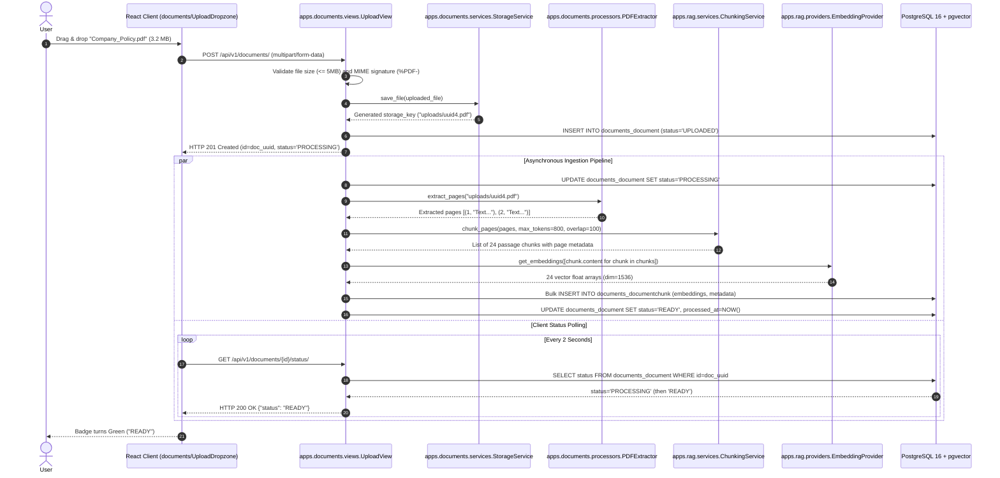
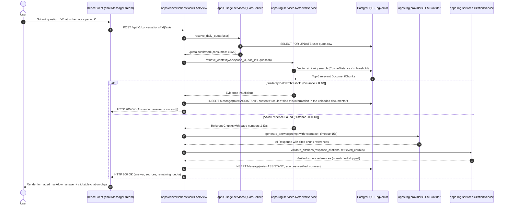

# System Modules & Architecture Specification
## AI Document Intelligence Workspace

- **Document Identifier:** MOD-AI-DOC-2026-V1.0
- **Version:** 1.1.0
- **Status:** Architectural Baseline (Modular Architecture & Code Limit Standard)
- **Date:** October 2026
- **Architecture Pattern:** Fully Modular Django Backend (`apps/` Sub-Packages) + Domain-Driven React SPA

---

## 1. Architectural Overview & Modular Philosophy

The **AI Document Intelligence Workspace** adheres to a strictly decoupled, domain-driven modular architecture. The design prevents monolithic "fat files" and tightly coupled code through four core principles:

1. **Centralized Domain Apps Directory (`backend/apps/`):** All Django applications are contained within a dedicated `apps/` directory rather than being scattered across the root repository, providing clear namespace separation from project configuration (`config/`).
2. **Sub-Package Modularity per Application:** No application uses flat monolithic files (`models.py`, `views.py`, `serializers.py`, `admin.py`, `services.py`, `tests.py`). Each component is structured as a dedicated Python package with an `__init__.py` containing focused, single-responsibility modules.
3. **Dedicated Admin Sub-Packages:** In accordance with modular standards, all Django admin configurations are organized inside dedicated `admin/` packages within each application, separating admin viewsets and field formatting from domain logic.
4. **Architectural Code Limit Rule (Max 600 Lines of Code per File):** No single source file (Python or JavaScript/JSX) shall exceed **600 lines of code**. Files reaching ~450–500 lines must be proactively decomposed into smaller sub-modules.
5. **Provider Abstraction & Test Mockability:** External AI services (embedding generators and LLMs) sit behind strict abstract interfaces, allowing 100% deterministic local testing without external API costs or network delays.
6. **Multi-Tenant Scoping:** All database queries and vector similarity searches are strictly filtered by workspace ownership (`workspace__owner=request.user`) at the service and ORM levels.

```text
+---------------------------------------------------------------------------------------------------+
|                                     REACT FRONTEND (MODULAR SPA)                                  |
|   +-------------------------------------------------------------------------------------------+   |
|   | src/modules/                                                                              |   |
|   |  ├── auth/         ├── documents/         ├── chat/              ├── usage/               |   |
|   |  (Login/Register)  (Upload/Poll/List)     (Stream/Citations)     (Atomic Quota Meter)     |   |
|   +-------------------------------------------------------------------------------------------+   |
+-------------------------------------------------+-------------------------------------------------+
                                                  | HTTPS / REST JSON (/api/v1/)
                                                  v
+---------------------------------------------------------------------------------------------------+
|                                       DJANGO API GATEWAY                                          |
|                                       backend/config/                                             |
+-------------------------------------------------+-------------------------------------------------+
                                                  | Internal App Routing
                                                  v
+---------------------------------------------------------------------------------------------------+
|                                  DEDICATED APPS ROOT (backend/apps/)                              |
|  +--------------------+  +--------------------+  +--------------------+  +---------------------+  |
|  | apps/accounts/     |  | apps/workspaces/   |  | apps/documents/    |  | apps/rag/           |  |
|  | models/ views/     |  | models/ views/     |  | models/ views/     |  | services/ pipeline/ |  |
|  | serializers/ admin/|  | serializers/ admin/|  | processors/ admin/ |  | providers/ prompts/ |  |
|  +--------------------+  +--------------------+  +--------------------+  +---------------------+  |
|  +--------------------------------------------+  +---------------------------------------------+  |
|  | apps/conversations/                        |  | apps/usage/                                 |  |
|  | models/ views/ serializers/ admin/         |  | models/ views/ services/ admin/             |  |
|  +--------------------------------------------+  +---------------------------------------------+  |
+-------------------------------------------------+-------------------------------------------------+
                                                  |
       +------------------------------------------+-----------------------------------------+
       |                                          |                                         |
       v                                          v                                         v
+-------------------------------+  +-------------------------------+  +-----------------------------+
| PostgreSQL 16 + pgvector      |  | Private File Storage          |  | External AI Provider / Mock |
| - HNSW Vector Index (Cosine)  |  | - UUID Random Storage Keys    |  | - Embedding Provider        |
| - Relational User & App Data  |  | - Private Root (Non-public)   |  | - LLM Completion Provider   |
+-------------------------------+  +-------------------------------+  +-----------------------------+
```

---

## 2. Engineering Architectural Rule: Max 600 Lines of Code (LOC)

To ensure code maintainability, clean Git diffs, test isolation, and strict adherence to the Single Responsibility Principle (SRP), the project enforces the following rule:

### 2.1 The 600-Line Limit Standard
- **Rule:** **No single file in the backend (Python) or frontend (JavaScript/JSX/CSS) shall exceed 600 lines of code.**
- **Enforcement:**
  - Code reviews and linting checks reject any PR containing files with $> 600$ lines.
  - Developers must refactor when a file approaches **450–500 lines**.

### 2.2 Decomposition & Refactoring Strategy
When a component grows, it must be split across the sub-package structure:
- **Models:** Instead of a bloated `models.py`, use `models/` (e.g., `models/document.py`, `models/chunk.py`, with exports aggregated in `models/__init__.py`).
- **Views:** Instead of a single `views.py`, use `views/` (e.g., `views/upload.py`, `views/status.py`, `views/detail.py`).
- **Serializers:** Decompose by action or entity (e.g., `serializers/request.py`, `serializers/response.py`).
- **Admin:** Separate admin models into dedicated files within the `admin/` folder (e.g., `admin/document_admin.py`, `admin/chunk_admin.py`).
- **Frontend Components:** Decompose large page views into modular atoms, molecules, and custom hooks under 300 lines each.

---

## 3. Backend Module Deep Dive (`backend/apps/`)

### 3.1 Directory Topology

All domain logic is encapsulated inside `backend/apps/`, completely isolated from global configuration:

```text
backend/
├── manage.py
├── config/                     # Project root configuration
│   ├── settings/
│   │   ├── __init__.py
│   │   ├── base.py             # Shared settings (installed apps, middleware)
│   │   ├── local.py            # Local dev settings
│   │   └── production.py       # Production security settings
│   ├── urls.py                 # Top-level API router mounting /api/v1/
│   ├── wsgi.py
│   └── asgi.py
│
└── apps/                       # DEDICATED DOMAIN APPS ROOT
    ├── accounts/               # User authentication, custom user model, tokens
    ├── workspaces/             # Multi-tenant workspace container & isolation
    ├── documents/              # Document upload, parsing, storage, chunk persistence
    ├── rag/                    # Chunking, vector embeddings, similarity search, LLM
    ├── conversations/          # Chat sessions, message history, source mapping
    └── usage/                  # Atomic concurrency-safe quota tracking & limits
```

---

### 3.2 Module Breakdown

```text
apps/accounts/
├── __init__.py
├── apps.py
├── urls.py
├── admin/                      # Modular Admin Sub-Package
│   ├── __init__.py
│   └── user_admin.py           # CustomUserAdmin with fieldsets and filters
├── models/                     # Modular Models Sub-Package
│   ├── __init__.py             # Exports CustomUser, UserProfile
│   ├── user.py                 # CustomUser extending AbstractBaseUser
│   └── profile.py              # UserProfile storing quota references
├── serializers/                # Modular Serializers Sub-Package
│   ├── __init__.py
│   ├── register.py             # Registration & password validation
│   ├── login.py                # Token obtain pair serializer
│   └── user.py                 # User detail & profile serializer
├── views/                      # Modular Views Sub-Package
│   ├── __init__.py
│   ├── register_view.py        # POST /auth/register/
│   ├── token_views.py          # POST /auth/login/, /auth/token/refresh/
│   └── profile_view.py         # GET /auth/me/
├── services/                   # Modular Business Services
│   ├── __init__.py
│   └── auth_service.py         # Registration workflow & JWT issuance
├── permissions/                # Modular Permissions
│   ├── __init__.py
│   └── active_user.py          # IsActiveUser verification
└── tests/                      # Modular Test Suite
    ├── __init__.py
    ├── test_models.py
    ├── test_registration.py
    └── test_auth_api.py
```

#### Detailed App Responsibilities:

#### 1. `apps.accounts` (Identity & Token Lifecycle)
- **`models/user.py`:** `CustomUser` model utilizing `email` as the `USERNAME_FIELD` (case-insensitive), with password hashing via PBKDF2/Argon2.
- **`models/profile.py`:** Tracks auxiliary profile metadata and links to the user's active workspace.
- **`admin/user_admin.py`:** Clean Django Admin interface for superusers to inspect registered accounts with email search and active status filters.
- **`views/`:** Clean DRF endpoints returning standard JWT tokens (`access`, `refresh`).

---

#### 2. `apps.workspaces` (Tenant Boundary & Access Control)
- **Folder Structure:** Contains `admin/`, `models/`, `serializers/`, `views/`, `services/`, `permissions/`, and `tests/`.
- **`models/workspace.py`:** `Workspace` model containing `id` (UUID), `owner` (ForeignKey to `CustomUser`), and `name`.
- **`permissions/ownership.py`:** `IsWorkspaceOwner` permission verifying `request.user == obj.owner`. Ensures any request with a forged `workspace_id` is rejected with HTTP 403/404.
- **`services/workspace_service.py`:** Automatically creates a "Default Workspace" upon user registration and enforces workspace existence checks.
- **`admin/workspace_admin.py`:** Admin registration displaying workspace owner, document counts, and creation timestamps.

---

#### 3. `apps.documents` (Ingestion, Parsing & Storage)
- **Folder Structure:** Contains `admin/`, `models/`, `serializers/`, `views/`, `services/`, `processors/`, and `tests/`.

```text
apps/documents/
├── admin/
│   ├── __init__.py
│   ├── document_admin.py       # Document admin with status badges & error codes
│   └── chunk_admin.py          # DocumentChunk admin with page & vector inspect
├── models/
│   ├── __init__.py             # Exports Document, DocumentChunk
│   ├── document.py             # Document entity & status state machine
│   └── chunk.py                # DocumentChunk with pgvector VectorField(1536)
├── serializers/
│   ├── __init__.py
│   ├── upload_serializer.py    # Multipart file validation (size, MIME, ext)
│   └── document_serializer.py  # Document detail & list representation
├── views/
│   ├── __init__.py
│   ├── upload_view.py          # POST /api/v1/documents/
│   ├── list_view.py            # GET /api/v1/documents/ (paginated)
│   ├── detail_view.py          # GET /api/v1/documents/{id}/, DELETE
│   └── status_view.py          # GET /api/v1/documents/{id}/status/
├── services/
│   ├── __init__.py
│   ├── storage_service.py      # UUID storage key generation & secure disk I/O
│   └── deletion_service.py     # Atomic cascading deletion of files and chunks
├── processors/                 # Document Extractors (< 300 LOC each)
│   ├── __init__.py
│   ├── base.py                 # Abstract BaseExtractor class
│   ├── pdf_extractor.py        # PyMuPDF (fitz) page-by-page extractor
│   ├── docx_extractor.py       # python-docx paragraph/table extractor
│   └── txt_extractor.py        # Streaming UTF-8 plain text reader
└── tests/
    ├── __init__.py
    ├── test_validators.py      # MIME & size limit tests
    ├── test_extractors.py      # PDF, DOCX, TXT extraction tests
    └── test_document_api.py    # Endpoints & cascading deletion tests
```

- **`models/document.py`:** Stores file metadata with lifecycle statuses: `UPLOADED` -> `PROCESSING` -> `READY` / `FAILED`.
- **`models/chunk.py`:** Stores chunks with `content`, `page_number`, `chunk_index`, and `embedding` (`VectorField(dimensions=1536)`). Unique constraint on `(document_id, chunk_index)`.
- **`processors/pdf_extractor.py`:** Utilizes `PyMuPDF` to read PDF streams, extract clean text blocks, and record exact 1-indexed page numbers.
- **`services/deletion_service.py`:** Guarantees atomic relational and disk cleanup when a document is deleted.

---

#### 4. `apps.rag` (Retrieval-Augmented Generation Subsystem)
- **Folder Structure:** Contains `providers/`, `services/`, `prompts/`, `pipeline/`, and `tests/`.

```text
apps/rag/
├── providers/                  # External AI Provider Adapters & Mocks
│   ├── __init__.py
│   ├── base.py                 # Abstract IEmbeddingProvider, ILLMProvider
│   ├── openai_provider.py      # OpenAI text-embedding-3-small & gpt-4o-mini
│   ├── gemini_provider.py      # Google Gemini embedding & generation
│   └── mock_provider.py        # Deterministic mock provider for tests
├── services/                   # RAG Core Services
│   ├── __init__.py
│   ├── chunking_service.py     # Paragraph-aware chunker (500-1000 tokens)
│   ├── retrieval_service.py    # pgvector HNSW cosine search (<=>)
│   └── citation_service.py     # Source validation against retrieved chunks
├── prompts/                    # System Prompts & Injection Defense
│   ├── __init__.py
│   └── prompt_builder.py       # XML <context> wrapper & passive data guards
├── pipeline/                   # Master Workflow Orchestrator
│   ├── __init__.py
│   └── rag_pipeline.py         # End-to-end question answering pipeline
└── tests/
    ├── __init__.py
    ├── test_chunker.py
    ├── test_retrieval.py
    ├── test_grounding.py
    └── test_rag_pipeline.py
```

- **`services/chunking_service.py`:** Chunks normalized text into 500–1,000 token segments with 50–150 token overlap, preserving paragraph boundaries.
- **`services/retrieval_service.py`:** Executes pgvector similarity queries strictly filtered by `document__workspace_id` and selected `document_ids`. Evaluates relevance score: if cosine distance $> 0.40$, triggers safe abstention without calling the LLM.
- **`prompts/prompt_builder.py`:** Wraps retrieved passages in `<context>` blocks and injects system instructions commanding the model to treat document content as untrusted passive data (prompt injection defense).
- **`services/citation_service.py`:** Validates that cited chunk IDs exist within the retrieved set; strips hallucinated IDs or page references.

---

#### 5. `apps.conversations` (Chat Sessions & Messages)
- **Folder Structure:** Contains `admin/`, `models/`, `serializers/`, `views/`, `services/`, and `tests/`.
- **`models/conversation.py`:** `Conversation` thread containing title, workspace FK, and timestamps.
- **`models/message.py`:** `Message` storing `role` (`USER`/`ASSISTANT`), `content`, `status` (`COMPLETED`/`FAILED`), and `sources` (JSONB containing filename, page number, chunk ID, and excerpt).
- **`views/ask_view.py`:** Handles `POST /api/v1/conversations/{id}/ask/`, coordinates quota reservation, invokes the RAG pipeline, and logs the response.
- **`admin/conversation_admin.py`:** Django Admin views allowing inspection of conversation threads and message source payloads.

---

#### 6. `apps.usage` (Atomic Quota Enforcement & Audit)
- **Folder Structure:** Contains `admin/`, `models/`, `serializers/`, `views/`, `services/`, and `tests/`.
- **`models/usage_record.py`:** Stores audit records of AI interactions with timestamps and status.
- **`services/quota_service.py`:**
  - Implements concurrency-safe row-level locking via `select_for_update()`.
  - Enforces the hard cap of 20 questions/day/user.
  - Automatically resets counters at 00:00 UTC.
  - Implements compensation rollback: refunds reserved quota if an upstream AI provider fails with a 5xx timeout.
- **`views/usage_view.py`:** `GET /api/v1/usage/` returns `{ "limit": 20, "used": X, "remaining": 20-X, "reset_time": "<iso>" }`.
- **`admin/usage_admin.py`:** Visualizes user consumption and tracks audit records in Django Admin.

---

## 4. Frontend Modular Architecture (`frontend/src/`)

To mirror the backend's clean modular structure, the React + Vite frontend is organized into domain-driven feature modules under `src/modules/`:

```text
frontend/src/
├── api/                        # Shared Axios client & global interceptors
│   ├── axios_client.js         # Axios instance with baseURL & JWT injector
│   └── error_handler.js        # Global HTTP error normalizer
│
├── context/                    # Cross-cutting global React Contexts
│   ├── auth_context.jsx        # JWT state, login/logout, user profile
│   └── theme_context.jsx       # Theme state (dark/light mode)
│
├── components/                 # Global UI Design System (under 200 LOC each)
│   ├── ui/
│   │   ├── button.jsx
│   │   ├── badge.jsx
│   │   ├── modal.jsx
│   │   ├── spinner.jsx
│   │   └── alert.jsx
│   └── layout/
│       ├── navbar.jsx
│       ├── sidebar.jsx
│       └── app_layout.jsx
│
├── modules/                    # DOMAIN-DRIVEN FEATURE MODULES
│   ├── auth/                   # Authentication Module
│   │   ├── components/         # LoginForm.jsx, RegisterForm.jsx
│   │   ├── hooks/              # useAuth.js
│   │   ├── services/           # authApi.js
│   │   └── pages/              # LoginPage.jsx, RegisterPage.jsx
│   │
│   ├── documents/              # Document Management Module
│   │   ├── components/         # UploadDropzone.jsx, DocumentTable.jsx, DocumentCard.jsx
│   │   ├── hooks/              # useDocuments.js, useDocumentStatusPoller.js
│   │   ├── services/           # documentApi.js
│   │   └── pages/              # DocumentsPage.jsx
│   │
│   ├── chat/                   # RAG Conversational Workspace Module
│   │   ├── components/         # MessageStream.jsx, MessageBubble.jsx, CitationDrawer.jsx, SafeMarkdown.jsx
│   │   ├── hooks/              # useChat.js, useRAGQuery.js
│   │   ├── services/           # conversationApi.js
│   │   └── pages/              # ChatPage.jsx
│   │
│   └── usage/                  # Quota & Analytics Module
│       ├── components/         # QuotaProgressBar.jsx, LimitAlertModal.jsx
│       ├── hooks/              # useQuota.js
│       └── services/           # usageApi.js
│
├── hooks/                      # Shared utility hooks (useDebounce, useToggle)
├── utils/                      # Pure helpers (formatters.js, sanitizers.js)
├── App.jsx                     # Route registry (React Router 6)
└── main.jsx                    # Application entrypoint & DOM mount
```

### 4.1 Frontend Modularity Guidelines
- **Component File Limit:** No component or custom hook shall exceed **300 lines**. Pages act strictly as orchestrators uniting modular components.
- **Safe Markdown Rendering:** `SafeMarkdown.jsx` encapsulates `react-markdown` with `rehype-sanitize` to guarantee zero XSS vulnerabilities from AI responses or document excerpts.
- **Decoupled API Services:** Views never call Axios directly; they communicate through domain API services (e.g., `documentApi.js`, `conversationApi.js`).

---

## 5. Sequence Workflows & Inter-Module Communication

### 5.1 Document Upload, Processing & Vector Storage Workflow



### 5.2 Conversational RAG Query & Citation Verification Workflow



---

## 6. Interface Contracts & Service Definitions

Key backend interfaces are defined with explicit type hints to enforce separation and allow deterministic test mocking:

```python
# apps/rag/providers/base.py
from abc import ABC, abstractmethod
from typing import List, Dict, Optional
from dataclasses import dataclass

@dataclass
class RetrievedChunk:
    chunk_id: str
    document_id: str
    document_name: str
    page_number: Optional[int]
    content: str
    similarity_score: float

@dataclass
class RAGResponse:
    answer: str
    sources: List[Dict]
    is_abstention: bool
    model_name: str

class IEmbeddingProvider(ABC):
    @abstractmethod
    def embed_texts(self, texts: List[str]) -> List[List[float]]:
        """Converts strings into high-dimensional vector representations."""
        pass

class ILLMProvider(ABC):
    @abstractmethod
    def generate_completion(self, system_prompt: str, user_prompt: str) -> str:
        """Invokes language model with system constraints and user prompt."""
        pass

# apps/usage/services/quota_service.py
class IQuotaManager(ABC):
    @abstractmethod
    def reserve_quota(self, user_id: str) -> int:
        """Atomically checks and consumes a quota unit via row-level locks."""
        pass

    @abstractmethod
    def refund_quota(self, user_id: str) -> None:
        """Compensates user quota in the event of upstream AI API failure."""
        pass
```

---

## 7. Database Vector Optimization & Indexing

To guarantee query response times $< 200$ ms across tens of thousands of document chunks, pgvector's Hierarchical Navigable Small World (HNSW) index is configured:

```sql
-- Migration: Enable vector extension and configure HNSW index
CREATE EXTENSION IF NOT EXISTS vector;

-- Cosine similarity index for 1536-dimensional embeddings
CREATE INDEX IF NOT EXISTS idx_chunks_embedding_hnsw 
ON documents_documentchunk 
USING hnsw (embedding vector_cosine_ops)
WITH (m = 16, ef_construction = 64);
```

### Performance & Security Index Guidelines:
1. **Distance Metric:** Cosine distance (`vector_cosine_ops`) matches the standard metric for normalized semantic embeddings.
2. **Tenant Scoping Pushdown:** All queries prepend `WHERE document_id IN (...)` and `workspace_id = ...` to enforce tenant isolation before similarity ordering.
