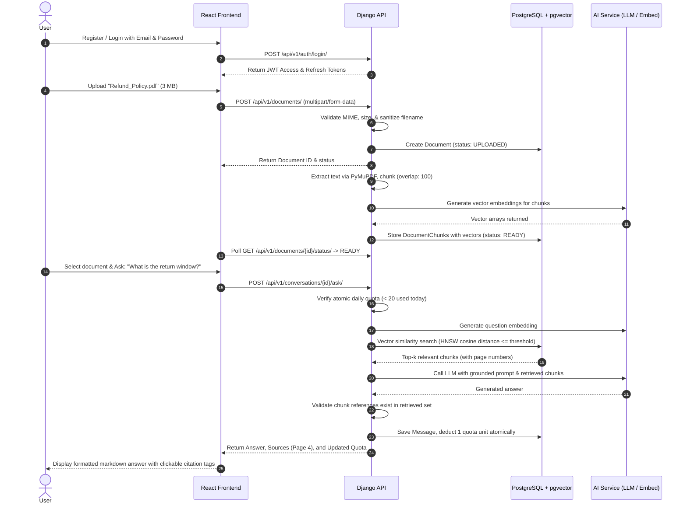
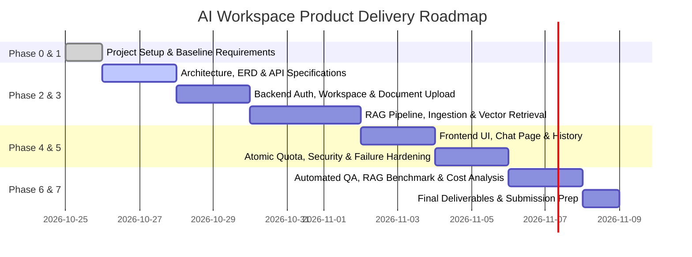

# Product Requirements Document (PRD)
## AI Document Intelligence Workspace

- **Document Version:** 1.0.0
- **Status:** Approved / Specification Baseline
- **Date:** October 2026
- **Product Type:** AI-Powered Document Intelligence SaaS
- **Architecture Pattern:** Client-Server / Retrieval-Augmented Generation (RAG)
- **Target Release:** Version 1.0 Minimum Viable Product (MVP)

---

## 1. Executive Summary & Vision

### 1.1 Product Overview
The **AI Document Intelligence Workspace** is a high-performance, security-focused web SaaS application that enables users to upload private documents (PDF, DOCX, TXT) and interact with their contents through natural-language conversation. 

Unlike generic AI chatbots that lack access to private user data or hallucinate unsupported claims, this platform couples semantic vector retrieval (via PostgreSQL + pgvector) with Large Language Models (LLMs) to deliver precise, fact-grounded answers accompanied by exact source citations (page numbers and excerpt snippets).

### 1.2 Vision Statement
To eliminate manual document scanning and keyword searches by providing an intelligent, transparent, and private document assistant that answers questions with verifiable evidence, enforces strict data privacy, and scales seamlessly from individuals to enterprise knowledge workers.

---

## 2. Problem Statement & Opportunity

### 2.1 The Problem
1. **Inefficient Information Retrieval:** Students, researchers, and enterprise workers spend hours manually reading through hundreds of pages of complex PDFs, contracts, policies, and manuals to locate specific answers.
2. **AI Hallucinations & Lack of Verifiability:** Standard foundation models hallucinate or generate fabricated details when asked about domain-specific or proprietary materials. Users cannot trust responses without verifiable source citations.
3. **Data Privacy & Tenant Exposure:** Users are hesitant to upload sensitive proprietary documents to public AI tools that might use their data for model retraining or expose it across user boundaries.
4. **Cost & Rate Runaways:** Uncontrolled AI querying leads to runaway operational costs for SaaS providers and unpredictability for end-users without transparent quota management.

### 2.2 The Solution
A dedicated RAG workspace providing:
- **Strict Tenant & Workspace Isolation:** Document vectors and records are isolated per user; cross-tenant document tampering is blocked at the database and query level.
- **Evidence-Grounded RAG Pipeline:** Queries are semantically matched against pre-chunked document vectors. Answers are generated *strictly* using retrieved evidence.
- **Transparent Citations:** Responses cite exact document names, page numbers, and passage excerpts.
- **Intelligent Abstention:** If a question cannot be answered from the uploaded text, the system explicitly abstains rather than inventing answers.
- **Concurrency-Safe Quota Control:** Predictable limits (e.g., 20 AI questions/day, 5 MB file size, 10 documents/workspace) with atomic, race-condition-free accounting.

---

## 3. Target Audience & User Personas

| Persona | Role & Context | Core Needs & Use Cases | Pain Points Solved |
|---|---|---|---|
| **Alex (Student / Academic)** | University graduate student reading textbooks and lecture notes | Ask conceptual questions across heavy reading materials; extract exam revision summaries | Eliminates hours of manual skimming; provides exact page references to cross-check |
| **Elena (Researcher / Scientist)** | PhD researcher analyzing technical reports and published papers | Query methodology sections, data findings, and literature reviews | Prevents hallucinated citations; quickly synthesizes findings across papers |
| **David (Corporate Employee)** | HR / Operations officer in a medium-sized enterprise | Query company policies, standard operating procedures (SOPs), and handbook rules | Finds specific policy clauses (e.g., travel refund limits) in seconds |
| **Marcus (Business / Legal Lead)** | Small business owner reviewing contracts, NDAs, and vendor agreements | Understand vendor terms, termination clauses, and liability limits | Identifies contractual obligations without missing small print |
| **Priya (Software Developer)** | Full-stack engineer navigating API docs and architectural specifications | Query SDK references, endpoint parameters, and architectural constraints | Instant answer lookup without leaving the development flow |

---

## 4. Scope & Boundary Definition

### 4.1 In-Scope (Minimum Viable Product - MVP)
- **Account & Workspace Management:**
  - Secure email-based registration and login via JWT.
  - Automatic single-tenant workspace creation per user.
  - User session management and `/auth/me/` profile retrieval.
- **Document Management:**
  - File upload supporting `.pdf`, `.docx`, and `.txt` files.
  - Multi-tier file validation (extension, MIME type, file header magic bytes, 5 MB size cap).
  - Secure storage abstraction using randomized UUID storage keys (original filenames protected).
  - Document status lifecycle: `UPLOADED` -> `PROCESSING` -> `READY` / `FAILED`.
  - Document listing, metadata viewing, and cascading deletion (removing chunks and embeddings).
- **Document Processing & RAG Ingestion:**
  - Text extraction preserving page numbers (PyMuPDF for PDF, python-docx for DOCX, native UTF-8 read for TXT).
  - Text normalization and paragraph-aware chunking (500–1,000 tokens with 50–150 token overlap).
  - Vector embedding generation (pluggable service with mock support for deterministic testing).
  - Storage of chunk embeddings in PostgreSQL with `pgvector` and HNSW indexing.
- **Question Answering & Grounding:**
  - Semantic vector similarity search filtered strictly by workspace and selected document IDs.
  - Relevance score thresholding: abstain with a pre-configured message if similarity is below threshold (without invoking the LLM).
  - Grounded prompt synthesis instructing the model to rely solely on provided excerpts and treat text as untrusted data (prompt injection defense).
  - Source citation generation (document name, page number, excerpt snippet) with backend ID verification.
- **History & Usage Management:**
  - Persistent conversation threads and chronological message histories.
  - Atomic, concurrency-safe daily quota tracking (default: 20 questions/day/user).
  - Failed request tracking and quota protection (quota not deducted on pre-processing or system failures).
  - Real-time usage display showing limit, consumed units, remaining quota, and reset timestamp.

### 4.2 Out-of-Scope (Version 1 / Deferred to Future Iterations)
- Paid billing integration (Stripe / LemonSqueezy) and dynamic subscription tiers.
- Multi-user team collaboration and shared workspace permissions (RBAC beyond owner).
- Optical Character Recognition (OCR) for scanned image-only PDFs.
- Audio / video transcription and spreadsheet/CSV parsing.
- Autonomous agentic tool use and multi-hop web browsing.
- Real-time collaborative document editing.
- Multi-provider dynamic LLM failover.
- Enterprise Single Sign-On (SAML 2.0 / Okta / Azure AD).
- Native mobile applications (iOS / Android).

---

## 5. End-to-End User Journeys

### 5.1 Primary Happy Path Journey

### 5.2 Exception & Edge-Case Journeys

#### Journey E-01: Unsupported Question (Abstention)
1. **Trigger:** User asks *"What is the CEO's birth date?"* against a document that only contains a company return policy.
2. **System Behavior:**
   - Vector similarity search returns chunks below the minimum confidence/relevance threshold.
   - The system intercepts the request **without calling the LLM API** (saving API costs).
   - Standardized response is returned: *"I couldn't find this information in the uploaded documents."*
   - Quota is deducted (or preserved, based on configured business policy), and response is logged with `sources: []`.

#### Journey E-02: Invalid / Malicious File Upload
1. **Trigger:** User attempts to upload an executable renamed to `.pdf` or a corrupted 12 MB file.
2. **System Behavior:**
   - Frontend client warns user if file extension is unapproved or size exceeds 5 MB.
   - Backend performs strict magic-byte MIME validation using `python-magic` / file inspection.
   - If validation fails, server immediately responds with HTTP 415 (Unsupported Media Type) or HTTP 413 (Payload Too Large).
   - No database chunking or external API calls are initiated; safe error message is displayed.

#### Journey E-03: Concurrency Race on Daily Quota
1. **Trigger:** User script dispatches 5 simultaneous questions when the user has only 1 remaining question quota.
2. **System Behavior:**
   - Backend wraps quota inspection and consumption inside a database transaction using row-level locking (`select_for_update()`).
   - The first transaction locks the record, verifies 19/20 used, increments to 20/20, and commits.
   - The subsequent 4 requests read 20/20 and are immediately rejected with HTTP 429 (`QUOTA_EXCEEDED`).
   - Zero quota leakages or over-budget LLM executions occur.

#### Journey E-04: Cross-Tenant Resource Tampering
1. **Trigger:** User A manipulates the network payload to pass a `document_id` belonging to User B.
2. **System Behavior:**
   - Every database query enforces an ownership constraint (`workspace__owner=request.user`).
   - The query returns empty or raises an ObjectDoesNotExist exception.
   - The API immediately returns HTTP 404 (or 403 Forbidden).
   - User B's documents, text chunks, and vector embeddings are never retrieved or exposed in prompts.

#### Journey E-05: Upstream AI API Timeout / Failure
1. **Trigger:** External LLM API suffers network outage, latency spike, or 429 rate limit.
2. **System Behavior:**
   - Backend service layer catches timeout using an explicit 15-second timeout window with bounded exponential backoff (max 2 retries for transient HTTP 503/429).
   - If failure persists, the transaction is safely rolled back.
   - Quota reservation is canceled; no units are deducted for system failures.
   - Client receives HTTP 504 / HTTP 502 with code `AI_SERVICE_UNAVAILABLE`. No raw API keys or internal stack traces are leaked.

---

## 6. Functional Requirements Summary

| Req ID | Module | Feature Name | Description | Priority |
|---|---|---|---|---|
| **FR-01** | Accounts | User Registration | Email/password sign-up with password hashing, uniqueness checks, and automatic workspace provisioning. | P0 (Must Have) |
| **FR-02** | Accounts | User Authentication | JWT login (access + refresh tokens), session validation, secure token revocation/logout. | P0 (Must Have) |
| **FR-03** | Workspaces | Workspace Access | Strict ownership verification ensuring complete multi-tenant data isolation across all endpoints. | P0 (Must Have) |
| **FR-04** | Documents | Document Upload | Multipart upload supporting PDF, DOCX, TXT; 5 MB size limit; 10 documents per user max; MIME validation. | P0 (Must Have) |
| **FR-05** | Documents / RAG | Ingestion Pipeline | Text extraction, cleaning, paragraph-aware chunking (500–1,000 tokens), vector embedding generation, and status updates. | P0 (Must Have) |
| **FR-06** | RAG | AI Question Answering | Semantic vector search in pgvector, relevance evaluation, prompt grounding, and LLM answer generation. | P0 (Must Have) |
| **FR-07** | RAG | Citation Verification | Real source citation generation (document name, page number, snippet) validated against retrieved chunk IDs. | P0 (Must Have) |
| **FR-08** | Conversations | Request History | Persistent conversation threads, user/assistant message history, citation storage, and status tracking. | P1 (Should Have) |
| **FR-09** | Usage | Concurrency Quota | Atomic enforcement of 20 questions/day limit; usage tracking; real-time quota status endpoint. | P0 (Must Have) |
| **FR-10** | RAG | Abstention Handling | Deterministic detection of unsupported queries without fabricating answers or wasting AI tokens. | P0 (Must Have) |
| **FR-11** | Core | Fault & Error Handling | Graceful degradation on upstream AI outages, invalid documents, or rate limits without exposing internals. | P0 (Must Have) |
| **FR-12** | Documents | Document Management | Listing documents, checking processing status, and cascading deletion of documents, chunks, and embeddings. | P0 (Must Have) |

---

## 7. Non-Functional Requirements & Constraints

### 7.1 Security & Privacy
- **Encryption:** TLS 1.3 in transit; sensitive credentials (API keys, database URLs) stored strictly in server-side environment variables.
- **Tenant Isolation:** Filter-level enforcement on all SQL queries ensuring users cannot read or search other users' vectors.
- **Prompt Injection Shielding:** Treat retrieved document content strictly as data inside delimiters (`<context> ... </context>`); explicitly instruct LLMs to ignore instructions embedded inside document text.
- **Sanitized Logging:** Never log raw document text, user passwords, or external API keys.

### 7.2 Performance & Responsiveness
- **Vector Retrieval Latency:** Vector similarity queries across user workspaces must complete in under 200 ms using pgvector HNSW indexing.
- **End-to-End Chat Latency:** Complete answer generation (retrieval + LLM completion) must complete within 3.0 to 5.0 seconds under normal provider conditions.
- **Document Ingestion:** A 50-page text PDF (< 3 MB) must complete parsing, chunking, and vectorization within 15 seconds.

### 7.3 Usability & UX Design
- **Clean Modern Interface:** Built using React + Vite with responsive layouts, clear visual states (empty, loading, error, success), and dark/light contrast.
- **Safe Markdown Rendering:** AI responses rendered using sanitized Markdown to support lists, bold text, and code snippets without allowing Cross-Site Scripting (XSS).
- **Transparency Indicators:** Real-time quota progress bar, processing status badges (`UPLOADED`, `PROCESSING`, `READY`, `FAILED`), and expandable citation snippets.

### 7.4 Engineering Quality & Architecture Standards
- **Dedicated Apps Directory:** All backend domain apps encapsulated inside `backend/apps/` (`accounts`, `workspaces`, `documents`, `rag`, `conversations`, `usage`).
- **Modular Sub-Package Structure:** Every app structured with dedicated sub-packages (`models/`, `views/`, `serializers/`, `services/`, `admin/`, `tests/`) with `__init__.py`.
- **Max 600 LOC per File Limit:** Hard ceiling of 600 lines of code per file across backend and frontend to enforce SRP and maintainability.
- **Modular Frontend Architecture:** Frontend organized into domain feature modules under `frontend/src/modules/` (`auth/`, `documents/`, `chat/`, `usage/`), with component files capped under 300 LOC.

---

## 8. Success Metrics & Key Performance Indicators (KPIs)

1. **Answer Grounding Rate:** ≥ 98% of generated claims directly supported by retrieved source text (zero tolerance for invented citations).
2. **Abstention Accuracy:** 100% abstention on queries where the uploaded document lacks relevant context.
3. **Citation Integrity:** 100% of generated source citations map to valid, existing chunk IDs in the database.
4. **Zero Cross-Tenant Leakage:** 0 incidents of cross-user document access or vector cross-contamination in automated security tests.
5. **Quota Enforcement Precision:** 100% accuracy in blocking parallel requests exceeding the daily limit (zero quota bypasses).

---

## 9. Product Roadmap & Phased Execution

